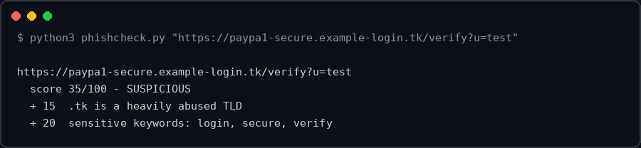

# phishcheck

Rule-based phishing URL risk scorer. Give it a URL, get a 0-100 score with every rule that fired, so you can see *why* it looks risky instead of trusting a black box.

Original code, no dependencies (Python 3.8+ stdlib only). The heuristics (IP hosts, punycode, `@` tricks, lookalike brand names) are standard phishing tells; this implementation is mine.

## Use

```sh
python3 phishcheck.py "http://paypal-secure.example.tk/login"
python3 phishcheck.py --file urls.txt --json
```

Exit code is 1 when any URL scores high risk, so it drops straight into scripts and CI.

## Rules

IP-as-host, `@` redirect trick, punycode, non-ASCII, subdomain depth, abused TLDs, URL shorteners, hyphen/digit runs, sensitive keywords (login, verify, UPI apps), brand lookalikes, base64-looking query blobs. Every rule lists its points.

## Tests

```sh
python3 -m unittest discover -s tests -v
```

Limitations: rules catch common patterns, not every phish. A low score is not a guarantee a link is safe.

## Sample output (real run)

```
$ python3 phishcheck.py "https://paypa1-secure.example-login.tk/verify?u=test"

https://paypa1-secure.example-login.tk/verify?u=test
  score 35/100 - SUSPICIOUS
  + 15  .tk is a heavily abused TLD
  + 20  sensitive keywords: login, secure, verify
```


